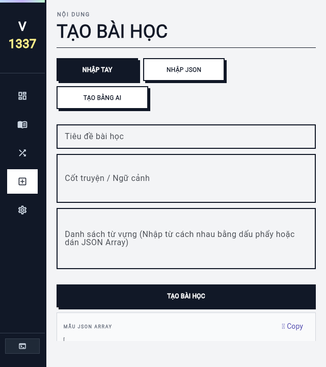

# Cải thiện lần 2 — 15/11/2026

## Những phần đã làm

- Tách dashboard, sidebar và học ngẫu nhiên sang `views/`. Các màn hình nhận callback điều hướng rõ ràng, không import ngược `main.py`.
- Gom bảng màu, viền, padding, nút và card vào `components/theme.py`. Giữ các khác biệt có chủ đích về cỡ chữ/khoảng cách của quiz và đọc hiểu.
- Chuyển toàn bộ thông báo SnackBar trong ứng dụng sang `page.show_dialog()`, thay cho gán thuộc tính `page.snack_bar` không được hiển thị đúng trên Flet hiện tại. Đóng dialog theo đúng đối tượng để không vô tình đóng SnackBar vừa mở thay cho hộp thoại.
- Cache Whisper có khóa bảo vệ khi nhiều luồng cùng nạp. Khi CUDA lỗi, dùng lại model CPU đã có; các lần gọi CUDA tiếp theo dùng cùng model và vẫn nhận cảnh báo fallback. Lần nạp thất bại có thể thử lại.
- Hủy AI không cho worker cũ ghi đè tiến độ, kết quả hay nút lưu của lượt mới. Lỗi bất ngờ cũng mở khóa điều hướng và khôi phục nút bắt đầu.
- Thời gian nghỉ giữa các lần thử có thể hủy; lỗi/hủy ở lần fallback flashcard được truyền lên thay vì âm thầm báo thành công với dữ liệu chưa được tạo. Nếu một flashcard thất bại hoàn toàn, hủy các tác vụ anh em còn lại mà không đổi tín hiệu hủy của người gọi.
- Đặt timeout cho Ollama SDK. Phân biệt timeout thật từ provider với thời gian chờ ngắn để kiểm tra nút hủy.
- Sidebar thu gọn còn icon có tooltip khi cửa sổ dưới 1000 px. Dashboard và form nhập bài học dùng bố cục đáp ứng; phần hướng dẫn JSON xuống dưới form khi hẹp.
- Dùng font Roboto có sẵn trong Flet, bỏ phụ thuộc vào CDN font. Nút sao chép mẫu JSON dùng Material Icon.
- Web phát âm thanh trên trình duyệt bằng `flet-audio==0.85.3`, dùng một trình phát cho mỗi page. Chỉ tạo trình phát khi có nguồn hợp lệ, bỏ kết quả tải về của yêu cầu cũ và hỗ trợ phát lại cùng đoạn âm thanh.
- Windows desktop tiếp tục dùng MCI/SAPI; không phụ thuộc vào đường phát web. Lỗi tạo/phát âm thanh được báo thay vì im lặng bỏ qua.
- `run.bat` kiểm tra thêm `flet_audio` để cài dependency mới khi cần. Bỏ cờ bỏ qua kiểm tra TLS trong lệnh cài đặt và cập nhật hướng dẫn CA tương ứng.

## Kiểm tra

```bash
python -m pip install -r requirements.txt
python -m unittest discover -s tests -v
python -m compileall -q main.py components views audio_processor.py tts_processor.py lesson_pipeline.py tests
```

31 tests đã qua, bao gồm 13 tests của đợt đầu. Các tests mới kiểm tra cache đồng thời, fallback, timeout, hủy và lỗi AI, worker cũ sau khi khởi động lượt mới, SnackBar và đường phát âm thanh/cache/phát lại. Không dùng API key hoặc dữ liệu học cá nhân trong tests.

Đã kiểm tra bằng Chromium headless trên Linux với SQLite và settings tạm riêng:

- Điều hướng dashboard, bài học và tạo bài học; sidebar thu gọn và form nhập ở 800 và 640 px.
- Trạng thái âm thanh `PLAYING` rồi `COMPLETED`, lặp lại hai lần với một MP3 thử được tạo cục bộ. Đây là kiểm tra đường phát thực của trình duyệt, không phải xác nhận chất lượng giọng đọc.
- Thay Whisper model trong Cài đặt và kiểm tra thông báo lưu xuất hiện.
- Dependency compatibility, biên dịch Python và `git diff --check` đều qua.



## Phạm vi còn lại

- Đã thử tạo giọng đọc từ Edge-TTS bằng một câu mẫu, nhưng kết nối tới `speech.platform.bing.com:443` thất bại (`ClientConnectorError`). Vì vậy phần tổng hợp giọng nói trực tuyến chưa được xác nhận trong cloud này; đường phát MP3 cục bộ đã được xác nhận riêng.
- Các tình huống lỗi và hủy AI được kiểm tra bằng provider mô phỏng; chưa kiểm tra toàn bộ pipeline với tài khoản Gemini/OpenAI hay Ollama thật. HTTP đã gửi có thể tiếp tục chạy tới timeout dù UI đã hủy; hủy không bảo đảm nhà cung cấp dừng xử lý yêu cầu đã nhận.
- Chưa kiểm tra micro/GPU hoặc Windows native. Script Windows được cập nhật dependency nhưng chưa chạy trên Windows.
- `main.py` vẫn chứa các màn hình lớn: tạo bài học/pipeline, cài đặt và trình sửa bài học. Tiếp tục tách từng phần sau khi có kiểm thử tương ứng.
- Bố cục nhỏ của các màn hình phức tạp như Pipeline Studio và trình sửa bài học vẫn cần rà thêm; chưa coi toàn ứng dụng là giao diện mobile hoàn chỉnh.

Không thay đổi schema SQLite hay ghi đè dữ liệu học hiện có.
