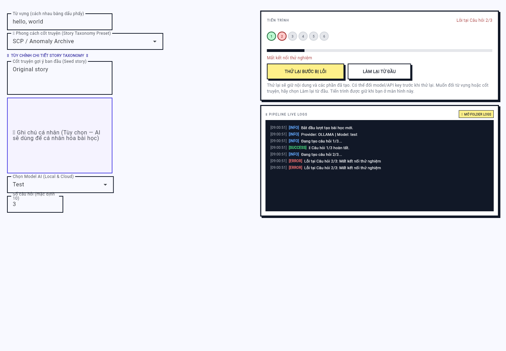

# Tiếp tục tạo bài học sau khi AI bị lỗi

Khi một bước thất bại, phần Tiến trình hiện lỗi và hai lựa chọn:

- **Thử lại bước bị lỗi**: giữ các phần đã hoàn thành, thử lại phần chưa xong rồi tiếp tục tới cuối.
- **Làm lại từ đầu**: bỏ tiến trình cũ và tạo bài học mới theo nội dung đang có trong form.

Ví dụ, câu hỏi số 4 bị lỗi thì thử lại sẽ giữ câu 1–3 và trạng thái câu chuyện sau câu 3. Nếu lỗi ở Master Challenge hoặc tổng hợp câu chuyện, các câu hỏi trước đó không bị tạo lại. Nếu lỗi khi tạo flashcard, các flashcard đã hoàn thành và được ghi nhận cũng được giữ lại.

Có thể đổi model, nhà cung cấp hoặc API key ngay trong tab trước khi thử lại. Từ vựng, cốt truyện, số câu hỏi, phong cách và ghi chú vẫn lấy từ lượt trước để tránh trộn nội dung. Muốn áp dụng thay đổi ở những phần này, chọn **Làm lại từ đầu**. Tên bài học khi lưu cũng lấy theo lượt tạo đã hoàn thành.

Tiến trình hiện được giữ trong bộ nhớ khi bạn còn ở màn hình tạo bài học. Chuyển sang màn hình khác, tải lại hoặc đóng ứng dụng sẽ không khôi phục được tiến trình này. Tính năng này không lưu API key vào bản giữ tiến trình và không thay đổi schema hay dữ liệu bài học hiện có.

## Kiểm tra

- 48 tests đã qua, gồm lỗi/thử lại ở từng giai đoạn, thử lại nhiều lần, giữ trạng thái câu chuyện, không lặp Master Challenge, giữ flashcard đã tạo, đổi kết nối, từ chối trộn đầu vào khác nhau, hủy và chống bấm lặp.
- Đã kiểm tra thao tác trên Chromium với provider mô phỏng lỗi ở câu 2: thử lại chỉ gọi lại câu 2 rồi tiếp tục câu 3; chạy lại bắt đầu từ câu 1 và dùng từ vựng mới.
- Các tests dùng phản hồi mô phỏng, không gọi Gemini/OpenAI/Ollama thật. Lỗi HTTP đang chạy vẫn có giới hạn hủy như đã ghi trong [báo cáo đợt trước](improvements-round-2.md).

```bash
python -m unittest discover -s tests -v
```

Ảnh giao diện trong phiên kiểm tra với dữ liệu thử:


