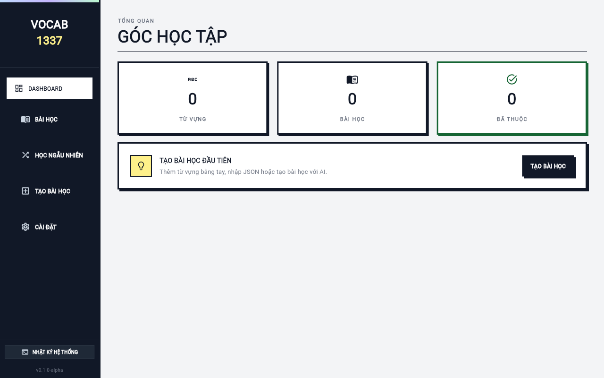
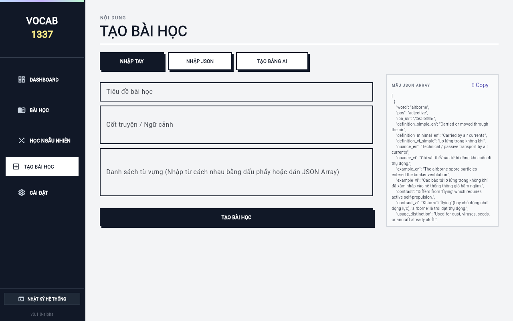

# Rà soát và cải thiện lần đầu — 15/11/2026

## Các lỗi đã sửa

- Nút micro trong flashcard và quiz truy cập `controls[1]` dù nút chỉ có một nhãn. Chọn nhãn cuối thay vì giả định luôn có icon riêng.
- Thiếu thư viện, không nạp được Whisper hoặc lỗi nhận dạng từng trả `passed=True` cùng câu mẫu giả. Nay trả lỗi riêng, không ghi nhận điểm và cho phép thử lại.
- Bản nhận dạng rỗng vẫn có thể đạt với từ ngắn như `a` vì khoảng cách Levenshtein nhỏ hơn ngưỡng. Nay yêu cầu có nội dung nhận dạng.
- Khi bắt đầu ghi âm lại, quiz giữ kết quả thành công cũ và cho phép nộp trong lúc nhận dạng. Nay xóa kết quả cũ và chặn nộp tới khi có kết quả mới.
- Mọi lượt ghi âm dùng chung `temp_pronunciation.wav`. Nay mỗi lượt có tệp riêng và dọn tệp tạm sau khi xử lý.
- Thiếu micro từng tạo WAV im lặng để tiếp tục chấm. Đã bỏ helper tạo âm thanh giả sau khi kiểm tra các nơi gọi; lỗi thiết bị được hiển thị cho người học.
- Import `sounddevice` thiếu PortAudio có thể ném `OSError`. Nay bắt cả lỗi này để UI còn hoạt động.
- Nhập JSON có `vocab=null`, phần tử không phải object, tên từ không phải chuỗi hoặc chỉ có khoảng trắng gây lỗi hoặc tạo dữ liệu xấu. Nay kiểm tra trước khi ghi DB; kiểm tra thêm cấu trúc `questions` và `flashcards`.
- Từ trùng, kể cả khác chữ hoa/thường, từng xuất hiện nhiều lần trong danh sách ID của bài học. Nay chỉ lưu mỗi ID một lần.

## UI

Giữ phong cách Neubrutalism: viền rõ, bóng cứng, nền sáng, sidebar tối.

- Thanh màu đầu sidebar có chiều cao cố định, bỏ `expand` khiến nó chiếm nhiều diện tích.
- Dùng Material Icons cho sidebar và các thẻ thống kê, tránh phụ thuộc emoji ở các vị trí này.
- Giảm bóng của thẻ thống kê, cân lại khoảng cách điều hướng, dùng màu nhấn dịu hơn.
- Dashboard trống dẫn tới tạo bài học; khi đã có bài học thì dẫn tới học tiếp.
- Các tab tạo bài học nằm gọn trên một hàng khi đủ chỗ và tự xuống hàng khi thiếu chỗ.
- Form nhập tay/JSON dùng hết chiều rộng cột; mẫu JSON có khung cuộn với chiều cao giới hạn.





## Kiểm tra

```bash
python -m unittest discover -s tests -v
python -m compileall -q main.py database.py ingestion.py audio_processor.py ai_generator.py lesson_pipeline.py components tests
```

13 tests: dữ liệu nhập sai, khử từ trùng, nhập/xuất bài mẫu; thiếu dependency/model, lỗi giải mã, im lặng, nhận dạng khớp; lỗi micro, tệp tạm; callback nút micro và ngăn nộp kết quả cũ sau khi ghi lại. Các tình huống thiết bị/mô hình được mô phỏng, không tải model hoặc gọi API.

Đã mở dashboard, danh sách bài học, học ngẫu nhiên, tạo bài học, cài đặt và tab nhập JSON bằng Chromium headless trên Linux. Đã xem ảnh dashboard, form nhập tay và nhập JSON. Chưa thử nhận dạng với micro thật, gọi AI thật hoặc chạy Windows native. Đây chưa phải kiểm thử toàn bộ ứng dụng.

## Những phần nên cải thiện tiếp

Đã tiếp tục xử lý các mục này trong [đợt cải thiện lần 2](improvements-round-2.md), kèm phạm vi đã kiểm tra và phần còn lại.

- Tách các màn hình khỏi `main.py` (~4.400 dòng), rồi gom màu sắc/nút/card đang lặp ở nhiều module. Cần làm từng màn hình và có kiểm thử điều hướng, không xóa hàng loạt helper chỉ vì tên giống nhau.
- Chuẩn hóa thông báo SnackBar/dialog theo API Flet hiện tại; nhiều nơi còn gán `page.snack_bar` theo cách cũ. Cần kiểm tra hiển thị thực tế trước khi thay đồng loạt.
- Hoàn thiện hiển thị lỗi và trạng thái hủy của pipeline AI với phản hồi thật từ từng nhà cung cấp.
- Kiểm tra cache Whisper khi fallback CUDA sang CPU và có nhiều lượt gọi cùng lúc; hiện cache chưa có khóa bảo vệ.
- Kiểm tra UI ở kích thước nhỏ hơn và thay các emoji còn lại nếu bị thiếu glyph. Đợt này chủ yếu xác nhận ở 1280×800.
- TTS hiện dùng cơ chế phát âm thanh của Windows; Linux web chưa có đường phát âm thanh tương đương.

Không xóa màn hình, prompt hay định dạng dữ liệu chỉ dựa vào việc chưa thấy trên UI. Không sửa dữ liệu học hiện có.
